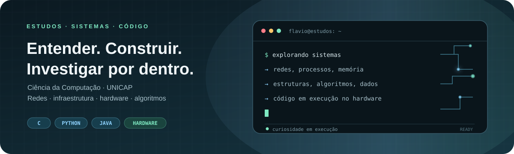

<h1 align="center">Flávio Daniel</h1>

  Estudante de Ciência da Computação na UNICAP · Técnico em Redes de Computadores

  

  

> Gosto de investigar o que acontece por baixo da interface: como os sistemas
> se organizam, como os dados percorrem uma rede e como código e hardware se
> encontram.

Meu foco de estudo passa por sistemas e infraestrutura, redes, hardware,
depuração de baixo nível, estruturas de dados e bancos de dados. Aqui reúno
projetos acadêmicos, exercícios e experimentos — cada um no seu contexto de
aprendizado.

  <a href="#projetos">Projetos</a> ·
  <a href="#minha-trilha-acadêmica-em-código">Estudos em código</a> ·
  <a href="#tecnologias-que-aparecem-nos-projetos">Tecnologias</a> ·
  <a href="#formação">Formação</a>

## Projetos

<table>
  <tr>
    <td width="50%" valign="top">
      <h3>🎬 Sistema de Cinema</h3>
      
Um projeto acadêmico de POO, desenvolvido em equipe de três pessoas em duas implementações independentes.

      <ul>
        <li><b>Terminal:</b> Java, MVC, Strategy para preços e persistência em arquivo.</li>
        <li><b>Web:</b> React + Vite, Spring Boot e H2.</li>
      </ul>
      
A versão web teve assistência de IA em parte do código.

      
<a href="https://github.com/Furubioo/Sistema-de-Cinema-JAVA-">Repositório</a> · <a href="https://github.com/Furubioo/Sistema-de-Cinema-JAVA-/tree/main/cinema-console">Terminal</a> · <a href="https://github.com/Furubioo/Sistema-de-Cinema-JAVA-/tree/main/cinema-system">Web</a>

    </td>
    <td width="50%" valign="top">
      <h3>🤝 Site ONG Partilhar</h3>
      
Site institucional para uma ONG, com conteúdo sobre acolhimento e bem-estar, serviços, galeria, depoimentos, voluntariado e doações.

      
Construído com HTML, CSS e JavaScript. O repositório contém a interface e seus recursos visuais; o projeto está publicado na Vercel.

      
<a href="https://github.com/Furubioo/SiteOngPartilhar">Ver código-fonte</a>

    </td>
  </tr>
</table>

### Por dentro do projeto de cinema

  

## Minha trilha acadêmica em código

O [repositório acadêmico](https://github.com/Furubioo/registro-academico-ciencia-da-computacao)
organiza estudos por disciplina e tema. São exercícios, revisões, notebooks e
projetos didáticos — não uma lista de tecnologias que afirmo dominar.

  

| Área | O que você encontra |
| --- | --- |
| [Python](https://github.com/Furubioo/registro-academico-ciencia-da-computacao/tree/main/fundamentos-python) | 61 exercícios de lógica, condicionais, laços, strings, funções e recursão |
| [Programação em C](https://github.com/Furubioo/registro-academico-ciencia-da-computacao/tree/main/programacao-estruturada-c) | 124 exercícios de fundamentos, vetores, matrizes, strings, ponteiros, structs e arquivos |
| [Estruturas de dados em C](https://github.com/Furubioo/registro-academico-ciencia-da-computacao/tree/main/estruturas-dados-c) | Listas, filas, pilhas, deques, tabela hash e aplicações como cadastros |
| [POO em Java](https://github.com/Furubioo/registro-academico-ciencia-da-computacao/tree/main/poo-java) | Projetos independentes de orientação a objetos |
| [Compiladores](https://github.com/Furubioo/registro-academico-ciencia-da-computacao/tree/main/construcao-compiladores) | Compilador de uma versão simplificada de C, com análise léxica, parser e testes |
| [Infraestrutura e concorrência](https://github.com/Furubioo/registro-academico-ciencia-da-computacao/tree/main/infraestrutura-software) | Algoritmo de Peterson, exclusão mútua e sincronização com threads |
| [Hardware](https://github.com/Furubioo/registro-academico-ciencia-da-computacao/tree/main/fundamentos-hardware) | Jogo de memória com botões, LEDs e GPIO em Raspberry Pi |
| [Álgebra linear computacional](https://github.com/Furubioo/registro-academico-ciencia-da-computacao/tree/main/algebra-linear-computacional) | Operações matriciais, sistemas lineares, cifra de Hill e transformações geométricas 2D/3D |
| [Cálculo computacional](https://github.com/Furubioo/registro-academico-ciencia-da-computacao/tree/main/calculo-computacional) | Notebooks de limites, derivadas, integrais, curvas, volumes e integrais duplas |
| [Métodos numéricos](https://github.com/Furubioo/registro-academico-ciencia-da-computacao/tree/main/metodos-numericos) | Modelagem e aproximação com notebooks sobre profundidade de tanque e densidade da água |
| [Projetos exploratórios](https://github.com/Furubioo/registro-academico-ciencia-da-computacao/tree/main/projetos-exploratorios) | Notebook de pré-processamento de dados categóricos para estudo de score de crédito |

O acervo está dividido em 11 áreas e também preserva projetos independentes
de Java e C. Consulte o
[README acadêmico](https://github.com/Furubioo/registro-academico-ciencia-da-computacao#readme)
para navegar por todas as disciplinas e orientações de execução.

## Tecnologias que aparecem nos projetos

  <kbd>C</kbd> <kbd>Python</kbd> <kbd>Java</kbd> <kbd>JavaScript</kbd>
  <kbd>HTML</kbd> <kbd>CSS</kbd> <kbd>React</kbd> <kbd>Vite</kbd>
  <kbd>Spring Boot</kbd> <kbd>H2</kbd> <kbd>Jupyter</kbd>
  <kbd>GitHub Actions</kbd> <kbd>Raspberry Pi / GPIO</kbd>

## Formação

- Ciência da Computação — 4º período, UNICAP
- Técnico em Redes de Computadores

  <i>Aprender, testar, depurar e entender o que acontece por dentro.</i>

