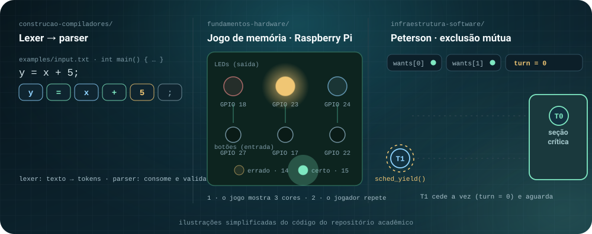

  

Sobre

Migrei de Sistemas de Informação para Ciência da Computação em busca de uma formação mais sólida em desenvolvimento de software. Minha curiosidade técnica começou mexendo em redes e hardware — hoje ela se estende para como sistemas são projetados, organizados em camadas e escalados, o que aplico em projetos como o Lumière Cinema, abaixo.

Tech Stack

 <picture> <source media="(prefers-color-scheme: dark)" srcset="https://skillicons.dev/icons?i=java,py,c,html,css,js&theme=dark" />  </picture> 
 
 <picture> <source media="(prefers-color-scheme: dark)" srcset="https://skillicons.dev/icons?i=react,vite,spring&theme=dark" />  </picture> 
 
 <picture> <source media="(prefers-color-scheme: dark)" srcset="https://skillicons.dev/icons?i=git,github,maven,vercel&theme=dark" />  </picture> 
 
 <picture> <source media="(prefers-color-scheme: dark)" srcset="https://skillicons.dev/icons?i=figma&theme=dark" />  </picture> 

Projeto em destaque — Lumière Cinema

Sistema de venda de ingressos de cinema, desenvolvido em equipe para a disciplina de Programação Orientada a Objetos da UNICAP, com fluxos distintos para usuário, crítico e administrador.

 <a href="https://github.com/Furubioo/Sistema-de-Cinema-JAVA-"> <picture> <source media="(prefers-color-scheme: dark)" srcset="https://github-readme-stats.vercel.app/api/pin/?username=Furubioo&repo=Sistema-de-Cinema-JAVA-&theme=tokyonight&hide_border=true" />  </picture> </a> 

Funcionalidades

Preços diferenciados por tipo de usuário (comum, crítico, estudante)
Aplicação de cupons promocionais
Sugestão de assentos e pôsteres de filme via API do TMDB
Persistência em arquivo na versão terminal, evoluindo para um banco H2 na versão web

Conceitos aplicados

Orientação a objetos: herança, sobrescrita e sobrecarga de métodos
Padrões de projeto MVC e Strategy (este último para as regras de preço)
Tratamento de exceções, incluindo uma exceção personalizada na base de código
evoluiu para
Versão web
React + Vite
Spring Boot
H2
Versão terminal — Java
View
Controller
Model + Strategy
Arquivo

Evolução O projeto começou como uma aplicação em terminal, em Java. Depois foi estendido para uma aplicação web (front-end em React + Vite, back-end em Spring Boot, H2 como banco de dados) — o código dessa etapa foi gerado com apoio de ferramentas de IA, e minha contribuição foi a configuração do ambiente, a integração entre front-end e back-end, e a resolução de bugs.

Em exploração agora
Estruturas de dados não lineares — árvores e algoritmos de ordenação
Projeto e modelagem de banco de dados
Análise e projeto de software
Projetos

 <a href="https://side-da-ong-partilhar.vercel.app"> <picture> <source media="(prefers-color-scheme: dark)" srcset="https://github-readme-stats.vercel.app/api/pin/?username=Furubioo&repo=SiteOngPartilhar&theme=tokyonight&hide_border=true" />  </picture> </a> 
 
<b>Site institucional — ONG Partilhar</b> · HTML, CSS e JavaScript, publicado na Vercel

Formação
<table> <tr><td><b>Ciência da Computação</b></td><td>UNICAP — Programa C3 · desde fev/2025 · 4º período em curso</td></tr> <tr><td><b>Técnico em Redes de Computadores</b></td><td>ETE Pastor Isaac Martins Rodrigues · 2020–2022</td></tr> </table>
Atividade

 <picture> <source media="(prefers-color-scheme: dark)" srcset="https://github-readme-stats.vercel.app/api?username=Furubioo&show_icons=true&theme=tokyonight&hide_border=true" />  </picture> <picture> <source media="(prefers-color-scheme: dark)" srcset="https://streak-stats.demolab.com?user=Furubioo&theme=tokyonight&hide_border=true" />  </picture> 

Contato

   
 
  

