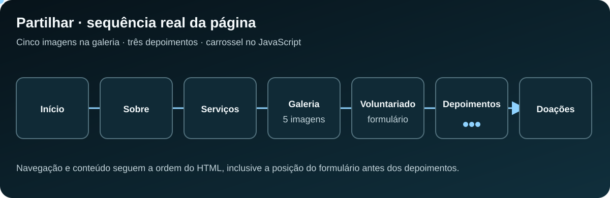
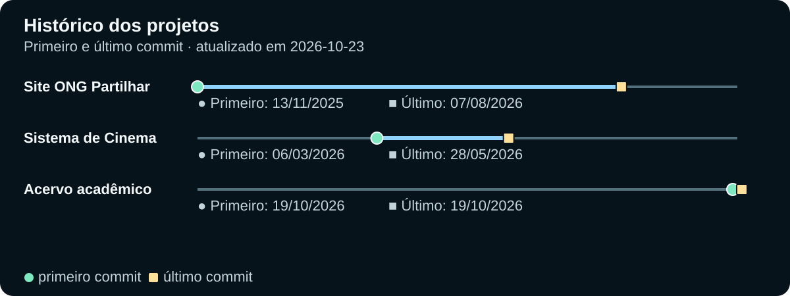

  <picture>
    <source media="(max-width: 600px) and (prefers-reduced-motion: reduce)" srcset="assets/hero-mobile-static.svg">
    <source media="(max-width: 600px)" srcset="assets/hero-mobile.svg">
    <source media="(prefers-reduced-motion: reduce)" srcset="assets/hero-static.svg">
    
  </picture>

> Meus focos de estudo são desenvolvimento de software e dados. Também tenho
> interesse em IA, ainda sem projetos de modelagem ou treinamento para apresentar.

Aqui reúno projetos acadêmicos, exercícios e experimentos — cada um no seu
contexto de aprendizado.

  <a href="#sobre">Sobre</a> ·
  <a href="#projetos-em-destaque">Projetos em destaque</a> ·
  <a href="#acervo-de-estudos">Acervo de estudos</a> ·
  <a href="#tecnologias">Tecnologias</a> ·
  <a href="#atividade-no-github">Atividade no GitHub</a> ·
  <a href="#formação">Formação</a>

## Sobre

Flávio Daniel é estudante de Ciência da Computação na UNICAP e técnico em Redes de Computadores. O foco principal de estudo está em desenvolvimento de software, dados e exploração de conceitos de IA como interesse acadêmico e experimental, sem projetos de modelagem ou treinamento para apresentar.

## Projetos em destaque

### Sistema de Cinema

Projeto acadêmico de POO, desenvolvido em equipe de três pessoas, em duas implementações independentes.

- **Terminal:** Java com `CinemaView`, `CinemaController` e `Usuario`; `EstrategiaPreco` oferece `PrecoComum` (preço-base), `PrecoCritico` (R$ 0) e `PrecoEstudante` (metade). Os dados são persistidos em `filmes.txt` e `usuarios.txt`.
- **Web:** páginas React + Vite usam Axios em `localhost:8080`; `POST /sessoes/{id}/comprar` chega a `SessaoController` e `SessaoRepository` (Spring Data JPA), com persistência em H2.

A versão web teve assistência de IA em parte do código.

[Repositório](https://github.com/Furubioo/Sistema-de-Cinema-JAVA-) ·
[Terminal](https://github.com/Furubioo/Sistema-de-Cinema-JAVA-/tree/main/cinema-console) ·
[Web](https://github.com/Furubioo/Sistema-de-Cinema-JAVA-/tree/main/cinema-system)

  <picture>
    <source media="(max-width: 600px) and (prefers-reduced-motion: reduce)" srcset="assets/cinema-flow-mobile-static.svg">
    <source media="(max-width: 600px)" srcset="assets/cinema-flow-mobile.svg">
    <source media="(prefers-reduced-motion: reduce)" srcset="assets/cinema-flow-static.svg">
    
  </picture>

### Site ONG Partilhar

Site institucional para uma ONG, com conteúdo sobre acolhimento e bem-estar, quatro categorias de serviços, galeria, depoimentos, voluntariado e doações. Construído com HTML, CSS e JavaScript e publicado na Vercel.

[Código-fonte](https://github.com/Furubioo/SiteOngPartilhar) ·
[Site publicado](https://side-da-ong-partilhar.vercel.app)

  <picture>
    <source media="(max-width: 600px) and (prefers-reduced-motion: reduce)" srcset="assets/partilhar-overview-mobile.svg">
    <source media="(max-width: 600px)" srcset="assets/partilhar-overview-mobile-animated.svg">
    <source media="(prefers-reduced-motion: reduce)" srcset="assets/partilhar-overview.svg">
    
  </picture>

O mapa segue a ordem do HTML — inclusive o formulário antes do carrossel e as doações depois — e não é uma captura da interface publicada.

## Acervo de estudos

O [repositório acadêmico](https://github.com/Furubioo/registro-academico-ciencia-da-computacao) reúne exercícios, revisões, notebooks, projetos didáticos e experimentos em múltiplas áreas. A seguir, as 11 áreas estão visíveis diretamente no perfil, sem menus ocultos.

  <picture>
    <source media="(max-width: 600px) and (prefers-reduced-motion: reduce)" srcset="assets/lab-mobile-static.svg">
    <source media="(max-width: 600px)" srcset="assets/lab-mobile.svg">
    <source media="(prefers-reduced-motion: reduce)" srcset="assets/lab-static.svg">
    
  </picture>

### Fundamentos e programação

- [Python](https://github.com/Furubioo/registro-academico-ciencia-da-computacao/tree/main/fundamentos-python) — 61 exercícios independentes de fundamentos e lógica.
- [C estruturado](https://github.com/Furubioo/registro-academico-ciencia-da-computacao/tree/main/programacao-estruturada-c) — 124 exercícios sobre fundamentos, vetores, matrizes, strings, ponteiros, structs e arquivos.

### Estruturas e arquitetura de software

- [Estruturas de dados em C](https://github.com/Furubioo/registro-academico-ciencia-da-computacao/tree/main/estruturas-dados-c) — listas, filas, pilhas, deques e tabela hash.
- [POO em Java](https://github.com/Furubioo/registro-academico-ciencia-da-computacao/tree/main/poo-java) — projetos didáticos independentes de orientação a objetos.
- [Construção de compiladores](https://github.com/Furubioo/registro-academico-ciencia-da-computacao/tree/main/construcao-compiladores) — tokens, lexer, parser e testes.
- [Infraestrutura de software e concorrência](https://github.com/Furubioo/registro-academico-ciencia-da-computacao/tree/main/infraestrutura-software) — algoritmo de Peterson e estudos de threads.

### Hardware e matemática computacional

- [Fundamentos de hardware](https://github.com/Furubioo/registro-academico-ciencia-da-computacao/tree/main/fundamentos-hardware) — Raspberry Pi, GPIO, LEDs, botões e lógica de controle.
- [Álgebra linear computacional](https://github.com/Furubioo/registro-academico-ciencia-da-computacao/tree/main/algebra-linear-computacional) — matrizes, sistemas lineares, cifra de Hill e transformações 2D/3D.
- [Cálculo computacional](https://github.com/Furubioo/registro-academico-ciencia-da-computacao/tree/main/calculo-computacional) — limites, derivadas, integrais, curvas e volumes.
- [Métodos numéricos](https://github.com/Furubioo/registro-academico-ciencia-da-computacao/tree/main/metodos-numericos) — notebooks de modelagem e aproximação.

### Dados

- [Projetos exploratórios](https://github.com/Furubioo/registro-academico-ciencia-da-computacao/tree/main/projetos-exploratorios) — notebooks e experimentos de análise e pré-processamento de dados.

O acervo também preserva projetos independentes de Java e C. Consulte o [README acadêmico](https://github.com/Furubioo/registro-academico-ciencia-da-computacao#readme) para aprofundamento e execução das disciplinas.

## Tecnologias

Ferramentas presentes nos projetos e estudos — a lista descreve o contexto do código, não um nível uniforme de domínio:

- **Projetos:** Java, React, Vite, Spring Boot, Maven, H2, HTML, CSS e JavaScript.
- **Estudos:** C, Python, Java e notebooks Jupyter.
- **Ambiente e hardware:** Git, GitHub, Vercel, Raspberry Pi e GPIO.

## Atividade no GitHub

  <picture>
    <source media="(max-width: 600px)" srcset="assets/project-timeline-mobile.svg">
    
  </picture>

Datas do primeiro e do último commit (data do committer), consultadas na API REST pública do GitHub e atualizadas diariamente por workflow, sem token pessoal. <a href="https://github.com/Furubioo/Sistema-de-Cinema-JAVA-">Sistema de Cinema</a> · <a href="https://github.com/Furubioo/registro-academico-ciencia-da-computacao">Acervo acadêmico</a> · <a href="https://github.com/Furubioo/SiteOngPartilhar">Site ONG Partilhar</a>. O <a href="https://github.com/Furubioo">perfil no GitHub</a> continua sendo a fonte oficial das contribuições.

## Formação

- Ciência da Computação — 4º período, UNICAP
- Técnico em Redes de Computadores

  <i>Aprender, testar, depurar e entender o que acontece por dentro.</i>

