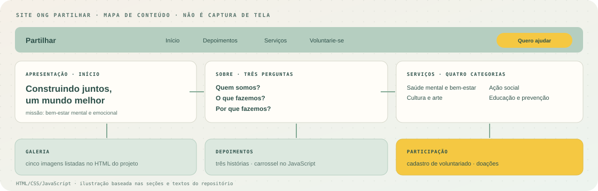
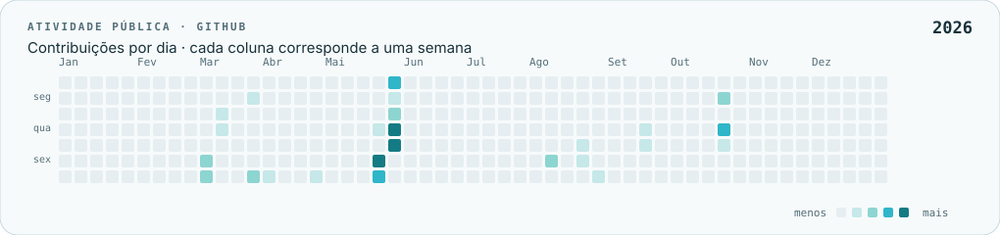

  <picture>
    <source media="(max-width: 600px) and (prefers-reduced-motion: reduce)" srcset="assets/hero-mobile-static.svg">
    <source media="(max-width: 600px)" srcset="assets/hero-mobile.svg">
    <source media="(prefers-reduced-motion: reduce)" srcset="assets/hero-static.svg">
    
  </picture>

> Gosto de investigar o que acontece por baixo da interface: como os sistemas
> se organizam, como os dados percorrem uma rede e como código e hardware se
> encontram.

Aqui reúno projetos acadêmicos, exercícios e experimentos — cada um no seu
contexto de aprendizado.

  <a href="#projetos-em-destaque">Projetos em destaque</a> ·
  <a href="#estudos-em-código">Estudos em código</a> ·
  <a href="#tecnologias">Tecnologias</a> ·
  <a href="#atividade-no-github">Atividade no GitHub</a> ·
  <a href="#formação">Formação</a>

## Projetos em destaque

### Sistema de Cinema

Projeto acadêmico de POO, desenvolvido em equipe de três pessoas, em duas implementações independentes.

- **Terminal:** Java com `CinemaView`, controllers e modelos; `Usuario` delega o cálculo do ingresso a estratégias de preço e os dados são persistidos em arquivos.
- **Web:** páginas React + Vite comunicam via Axios com controllers Spring Boot, repositórios JPA e banco H2.

A versão web teve assistência de IA em parte do código.

[Repositório](https://github.com/Furubioo/Sistema-de-Cinema-JAVA-) ·
[Terminal](https://github.com/Furubioo/Sistema-de-Cinema-JAVA-/tree/main/cinema-console) ·
[Web](https://github.com/Furubioo/Sistema-de-Cinema-JAVA-/tree/main/cinema-system)

  <picture>
    <source media="(max-width: 600px) and (prefers-reduced-motion: reduce)" srcset="assets/cinema-flow-mobile-static.svg">
    <source media="(max-width: 600px)" srcset="assets/cinema-flow-mobile.svg">
    <source media="(prefers-reduced-motion: reduce)" srcset="assets/cinema-flow-static.svg">
    
  </picture>

### Site ONG Partilhar

Site institucional para uma ONG, com conteúdo sobre acolhimento e bem-estar, quatro categorias de serviços, galeria, depoimentos, voluntariado e doações. Construído com HTML, CSS e JavaScript e publicado na Vercel.

[Código-fonte](https://github.com/Furubioo/SiteOngPartilhar) ·
[Site publicado](https://side-da-ong-partilhar.vercel.app)

  <picture>
    <source media="(max-width: 600px)" srcset="assets/partilhar-overview-mobile.svg">
    
  </picture>

O mapa representa as seções encontradas no código; não é uma captura da interface publicada.

## Estudos em código

O [repositório acadêmico](https://github.com/Furubioo/registro-academico-ciencia-da-computacao)
organiza estudos por disciplina e tema: exercícios, revisões, notebooks e
projetos didáticos — não uma lista de tecnologias que afirmo dominar.

  <picture>
    <source media="(max-width: 600px) and (prefers-reduced-motion: reduce)" srcset="assets/lab-mobile-static.svg">
    <source media="(max-width: 600px)" srcset="assets/lab-mobile.svg">
    <source media="(prefers-reduced-motion: reduce)" srcset="assets/lab-static.svg">
    
  </picture>

<b>Ver as 11 áreas do acervo</b>

 

| Trilha de estudo | Áreas e exemplos |
| --- | --- |
| **Lógica e fundamentos** | [Python](https://github.com/Furubioo/registro-academico-ciencia-da-computacao/tree/main/fundamentos-python): 61 exercícios independentes; [C estruturado](https://github.com/Furubioo/registro-academico-ciencia-da-computacao/tree/main/programacao-estruturada-c): 124 exercícios independentes de fundamentos, vetores, matrizes, strings, ponteiros, structs e arquivos |
| **Estruturas de dados e orientação a objetos** | [Estruturas de dados em C](https://github.com/Furubioo/registro-academico-ciencia-da-computacao/tree/main/estruturas-dados-c): listas, filas, pilhas, deques e tabela hash; [POO em Java](https://github.com/Furubioo/registro-academico-ciencia-da-computacao/tree/main/poo-java): projetos didáticos independentes |
| **Compiladores, infraestrutura e hardware** | [Compiladores](https://github.com/Furubioo/registro-academico-ciencia-da-computacao/tree/main/construcao-compiladores): tokens, lexer, parser e testes; [Concorrência](https://github.com/Furubioo/registro-academico-ciencia-da-computacao/tree/main/infraestrutura-software): algoritmo de Peterson e threads; [Hardware](https://github.com/Furubioo/registro-academico-ciencia-da-computacao/tree/main/fundamentos-hardware): jogo de memória com LEDs, botões e GPIO em Raspberry Pi |
| **Matemática computacional** | [Álgebra linear](https://github.com/Furubioo/registro-academico-ciencia-da-computacao/tree/main/algebra-linear-computacional): matrizes, sistemas lineares, cifra de Hill e transformações 2D/3D; [Cálculo](https://github.com/Furubioo/registro-academico-ciencia-da-computacao/tree/main/calculo-computacional): limites, derivadas, integrais, curvas e volumes; [Métodos numéricos](https://github.com/Furubioo/registro-academico-ciencia-da-computacao/tree/main/metodos-numericos): notebooks de modelagem e aproximação |
| **Exploração e análise de dados** | [Projetos exploratórios](https://github.com/Furubioo/registro-academico-ciencia-da-computacao/tree/main/projetos-exploratorios): notebook de pré-processamento de dados categóricos para estudo de score de crédito |

O acervo também preserva projetos independentes de Java e C. Consulte o
[README acadêmico](https://github.com/Furubioo/registro-academico-ciencia-da-computacao#readme)
para navegar por todas as disciplinas e orientações de execução.

## Tecnologias

Ferramentas presentes nos projetos e estudos — a lista descreve o contexto do código, não um nível uniforme de domínio:

- **Projetos:** Java, React, Vite, Spring Boot, Maven, H2, HTML, CSS e JavaScript.
- **Estudos:** C, Python, Java e notebooks Jupyter.
- **Ambiente e hardware:** Git, GitHub, Vercel, Raspberry Pi e GPIO.

## Atividade no GitHub

  <picture>
    <source media="(prefers-color-scheme: dark)" srcset="assets/github-activity-dark.svg">
    
  </picture>

Calendário original armazenado no repositório e atualizado diariamente por workflow; usa somente a página pública de contribuições, sem token pessoal. Se uma atualização falhar, a última imagem válida permanece versionada. O <a href="https://github.com/Furubioo">perfil no GitHub</a> continua sendo a fonte oficial.

## Formação

- Ciência da Computação — 4º período, UNICAP
- Técnico em Redes de Computadores

  <i>Aprender, testar, depurar e entender o que acontece por dentro.</i>

