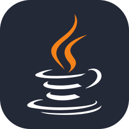
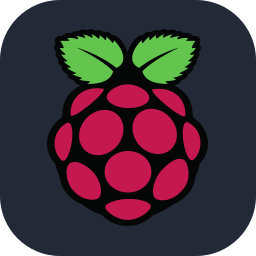

  <picture>
    <source media="(max-width: 600px) and (prefers-reduced-motion: reduce)" srcset="assets/hero-mobile-static.svg">
    <source media="(max-width: 600px)" srcset="assets/hero-mobile.svg">
    <source media="(prefers-reduced-motion: reduce)" srcset="assets/hero-static.svg">
    
  </picture>

> Meu interesse está no desenvolvimento de software, em dados e em inteligência
> artificial: construir aplicações e explorar como preparar, organizar e usar
> informações.

Projetos, estudos e experimentos — cada um com o contexto em que foi feito.

## Tecnologias

  <picture>
    <source media="(max-width: 600px) and (prefers-reduced-motion: reduce)" srcset="assets/tech-stack-mobile-static.svg">
    <source media="(max-width: 600px)" srcset="assets/tech-stack-mobile.svg">
    <source media="(prefers-reduced-motion: reduce)" srcset="assets/tech-stack-static.svg">
    
  </picture>

## Projetos

### Sistema de Cinema

Projeto acadêmico de POO, desenvolvido em equipe de três pessoas, em duas implementações independentes, com fluxos para usuário, crítico e administrador.

- **Terminal:** Java com `CinemaView`, controllers e modelos; `Usuario` delega o cálculo do ingresso a estratégias de preço (comum, crítico gratuito e estudante com metade) e os dados são persistidos em arquivos.
- **Web:** páginas React + Vite comunicam via Axios com controllers Spring Boot, repositórios Spring Data JPA e banco H2; a compra é validada no controller antes de gravar a cadeira.

A versão web teve assistência de IA em parte do código.

[Repositório](https://github.com/Furubioo/Sistema-de-Cinema-JAVA-) ·
[Terminal](https://github.com/Furubioo/Sistema-de-Cinema-JAVA-/tree/main/cinema-console) ·
[Web](https://github.com/Furubioo/Sistema-de-Cinema-JAVA-/tree/main/cinema-system)

  <picture>
    <source media="(max-width: 600px) and (prefers-reduced-motion: reduce)" srcset="assets/cinema-flow-mobile-static.svg">
    <source media="(max-width: 600px)" srcset="assets/cinema-flow-mobile.svg">
    <source media="(prefers-reduced-motion: reduce)" srcset="assets/cinema-flow-static.svg">
    
  </picture>

### Site ONG Partilhar

Site institucional para uma ONG, com conteúdo sobre acolhimento e bem-estar, serviços, galeria, depoimentos, voluntariado e doações. Construído com HTML, CSS e JavaScript. O site foi retirado do ar; o [código-fonte](https://github.com/Furubioo/SiteOngPartilhar) permanece disponível.

Ver a estrutura da página

  <picture>
    <source media="(max-width: 600px) and (prefers-reduced-motion: reduce)" srcset="assets/partilhar-overview-mobile-static.svg">
    <source media="(max-width: 600px)" srcset="assets/partilhar-overview-mobile.svg">
    <source media="(prefers-reduced-motion: reduce)" srcset="assets/partilhar-overview-static.svg">
    
  </picture>

Esquema do conteúdo encontrado no código; não é uma captura da interface.

## Estudos em código

O [repositório acadêmico](https://github.com/Furubioo/registro-academico-ciencia-da-computacao) reúne 11 áreas de estudo em 5 trilhas — exercícios, revisões, notebooks e projetos didáticos, não uma lista de tecnologias que afirmo dominar.

<table>
  <tr>
    <td width="132" align="center"> </td>
    <td><b>Lógica e fundamentos</b> <a href="https://github.com/Furubioo/registro-academico-ciencia-da-computacao/tree/main/fundamentos-python">Python</a>: 61 exercícios · <a href="https://github.com/Furubioo/registro-academico-ciencia-da-computacao/tree/main/programacao-estruturada-c">C estruturado</a>: 124 exercícios lógica, vetores, matrizes, strings, ponteiros, structs e arquivos</td>
  </tr>
  <tr>
    <td width="132" align="center"> </td>
    <td><b>Estruturas de dados e orientação a objetos</b> <a href="https://github.com/Furubioo/registro-academico-ciencia-da-computacao/tree/main/estruturas-dados-c">Estruturas de dados em C</a> · <a href="https://github.com/Furubioo/registro-academico-ciencia-da-computacao/tree/main/poo-java">POO em Java</a> listas, filas, pilhas, deques, tabela hash · projetos didáticos independentes</td>
  </tr>
  <tr>
    <td width="132" align="center">  </td>
    <td><b>Compiladores, concorrência e hardware</b> <a href="https://github.com/Furubioo/registro-academico-ciencia-da-computacao/tree/main/construcao-compiladores">Compiladores</a> · <a href="https://github.com/Furubioo/registro-academico-ciencia-da-computacao/tree/main/infraestrutura-software">Concorrência</a> · <a href="https://github.com/Furubioo/registro-academico-ciencia-da-computacao/tree/main/fundamentos-hardware">Hardware</a> lexer, parser e testes · algoritmo de Peterson e threads · jogo de memória com GPIO</td>
  </tr>
  <tr>
    <td width="132" align="center"></td>
    <td><b>Matemática computacional</b> <a href="https://github.com/Furubioo/registro-academico-ciencia-da-computacao/tree/main/algebra-linear-computacional">Álgebra linear</a> · <a href="https://github.com/Furubioo/registro-academico-ciencia-da-computacao/tree/main/calculo-computacional">Cálculo</a> · <a href="https://github.com/Furubioo/registro-academico-ciencia-da-computacao/tree/main/metodos-numericos">Métodos numéricos</a> notebooks: matrizes, cifra de Hill, transformações 2D/3D, limites, derivadas, integrais e modelagem</td>
  </tr>
  <tr>
    <td width="132" align="center"> </td>
    <td><b>Dados e aprendizado de máquina</b> <a href="https://github.com/Furubioo/registro-academico-ciencia-da-computacao/tree/main/projetos-exploratorios">Projetos exploratórios</a> score de crédito: variáveis categóricas, treino e teste, Random Forest e KNN</td>
  </tr>
</table>

Três deles em movimento:

  <picture>
    <source media="(max-width: 600px) and (prefers-reduced-motion: reduce)" srcset="assets/lab-mobile-static.svg">
    <source media="(max-width: 600px)" srcset="assets/lab-mobile.svg">
    <source media="(prefers-reduced-motion: reduce)" srcset="assets/lab-static.svg">
    
  </picture>

## Formação

- **Ciência da Computação** — UNICAP · desde 2025, conclusão prevista em 2028
- **Técnico em Redes de Computadores** — ETE Pastor Isaac Martins Rodrigues · 2020–2022
